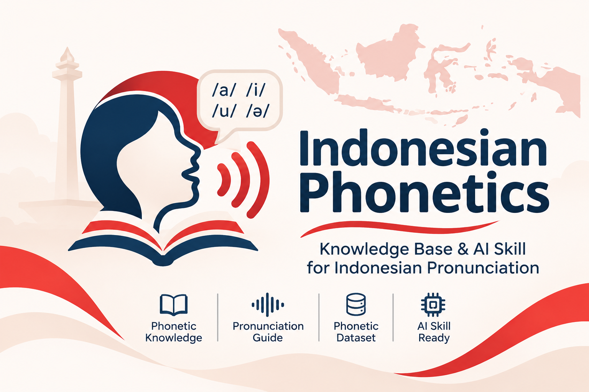

# Indonesian Phonetics



[](https://github.com/aqilwahid/indonesian-phonetics/actions/workflows/validate.yml)
  

Basis pengetahuan **fonetik, fonologi, dan pelafalan bahasa Indonesia** yang terstruktur dan siap dipakai AI: dokumentasi untuk manusia, dataset JSON tervalidasi skema untuk developer/NLP/TTS/ASR, dan **AI Skill** (konvensi Agent Skills) untuk AI Agent.

> **Status:** v1.0.0. Data lolos validasi skema, konsistensi, dan 92 uji otomatis, tetapi **belum ditinjau linguis/panel penutur** (`review_status: unreviewed` untuk semua entri). Lihat [Kualitas data](#kualitas-data).

## Tujuan dan ruang lingkup

- Menjelaskan sistem bunyi bahasa Indonesia: IPA, vokal, konsonan, fonem/alofon, diftong, suku kata, fonotaktik, tekanan, intonasi, proses fonologis, variasi regional.
- Merumuskan aturan membaca tulisan: grafem–fonem, huruf *e*, singkatan/akronim, kata serapan, ejaan lama, pengecualian.
- Menyediakan kamus pelafalan praktis: alfabet, singkatan, akronim, istilah teknologi/AI/data, merek, kata asing & serapan, angka, mata uang, satuan, simbol, tanggal & jam, istilah profesional/akademik, bentuk informal.
- Membekali AI Agent agar dapat menyiapkan teks untuk **TTS, voice-over, dan text normalization** secara peka konteks, konsisten, dan jujur terhadap ketidakpastian.

Setiap klaim diberi label **[Fakta]**, **[Variasi]**, atau **[Rekomendasi]**; setiap entri data menyimpan sumber (`source`), jenis asal (`provenance`: referensi ZIP / sumber eksternal / interpretasi), dan tingkat keyakinan (`confidence`).

## Fitur utama

| Fitur | Keterangan |
|---|---|
| Knowledge base modular | 8 dokumen inti di [`docs/`](docs/) + 7 topik rinci di [`knowledge/`](knowledge/), berbahasa Indonesia dengan IPA |
| Dataset 787 entri | 8 berkas JSON, 24 pola regex normalisasi, 85 entri ambigu dengan petunjuk disambiguasi, 388 entri ber-IPA (sisanya sengaja `null`) |
| Provenance eksplisit | 22 sumber terdaftar; 171 entri mengadopsi fakta dari materi referensi ZIP, dengan catatan ditulis ulang |
| Skema & validasi | JSON Schema 2020-12 + validator semantik (taksonomi, duplikasi, IPA, regex, provenance) |
| AI Skill | [`skills/indonesian-phonetics/`](skills/indonesian-phonetics/SKILL.md): progressive disclosure, 6 referensi, leksikon terbundel, skrip `lookup.py` & `normalize.py` |
| Normalizer konservatif | Angka, uang, persen, rentang, tanggal, jam, telepon, satuan; token ragu **dilindungi utuh** dan dilaporkan di daftar RAGU |
| Uji & CI | 92 kasus uji + GitHub Actions |

## Struktur repositori

```text
indonesian-phonetics/
├── README.md · LICENSE · CONTRIBUTING.md · CHANGELOG.md · requirements.txt
├── assets/banner.png
├── docs/                         # dokumen inti
│   ├── introduction.md           # ruang lingkup, tingkat klaim, status validasi
│   ├── phonetics.md              # alat ucap, fonem/alofon, transkripsi
│   ├── phonology.md              # ikhtisar sistem fonologis
│   ├── ipa.md                    # konvensi & tabel IPA
│   ├── pronunciation-rules.md    # grafem–fonem, singkatan, serapan, pengecualian
│   ├── data-standards.md         # skema, field, confidence, provenance, contoh kode
│   ├── sources.md                # daftar sumber (dari sources.json)
│   └── zip-reference-analysis.md # analisis & keputusan atas materi ZIP
├── knowledge/                    # topik rinci
│   ├── vowels.md · consonants.md · diphthongs.md · syllables.md
│   ├── stress-and-intonation.md · phonological-processes.md · regional-variations.md
├── dictionary/                   # dataset (sumber kebenaran)
│   ├── abbreviations.json  (110) · acronyms.json (136) · technology.json (205)
│   ├── loanwords.json (79) · numbers.json (82) · symbols.json (38)
│   ├── dates-and-times.json (57) · pronunciation-dictionary.json (80)
│   └── meta/ sources.json · taxonomy.json
├── schemas/                      # pronunciation / sources / tests (JSON Schema)
├── skills/indonesian-phonetics/  # AI Skill (Agent Skills)
│   ├── SKILL.md
│   ├── references/  phonetics · pronunciation-rules · normalization ·
│   │                ambiguity-and-variation · ipa-reference · dictionary-guide
│   ├── scripts/     lookup.py · normalize.py
│   └── assets/      lexicon.json (dibangkitkan dari dictionary/)
├── examples/                     # 5 contoh input → output
├── tests/pronunciation-tests.json
├── scripts/                      # validasi, uji, build
└── .github/workflows/validate.yml
```

## Memakai dataset

Setiap berkas: `{ "dataset", "version", "description", "entries": [...] }`. Field penting: `text` (bentuk tulis), `spoken_form` (bacaan default), `respelling` (ejaan bantu TTS), `ipa` (fonemis atau `null`), `variants`, `ambiguous`/`disambiguation`, `confidence`, `source`. Rincian: [docs/data-standards.md](docs/data-standards.md).

**Python**

```python
import json, pathlib
entries = [e for f in sorted(pathlib.Path("dictionary").glob("*.json"))
           for e in json.loads(f.read_text(encoding="utf-8"))["entries"]]
e = next(x for x in entries if x["text"] == "Shorts")
print(e["spoken_form"], "→ TTS:", e["respelling"])   # Shorts → TTS: syorts
```

**JavaScript (Node.js)**

```js
import { readFileSync, readdirSync } from "node:fs";
const entries = readdirSync("dictionary").filter(f => f.endsWith(".json"))
  .flatMap(f => JSON.parse(readFileSync(`dictionary/${f}`, "utf8")).entries);
const e = entries.find(x => x.text === "QRIS");
console.log(e.spoken_form, e.confidence); // kris standard
```

## Memakai AI Skill

Skill mengikuti [spesifikasi Agent Skills](https://agentskills.io/specification): `SKILL.md` berisi instruksi inti; detail dimuat bertahap dari `references/`; leksikon terbundel agar skill mandiri.

**Pasang** (contoh untuk agen yang membaca skill dari folder lokal, mis. Claude Code):

```bash
git clone https://github.com/aqilwahid/indonesian-phonetics.git
cp -r indonesian-phonetics/skills/indonesian-phonetics ~/.claude/skills/
```

Untuk platform lain, unggah/salin folder `skills/indonesian-phonetics/` sesuai cara platform memuat skill.

**Pakai** — cukup minta dalam bahasa alami, mis.:

> "Ubah naskah ini jadi teks TTS untuk ElevenLabs, gaya santai: *Webinar mulai 19.00 WIB, biayanya Rp25.000 (sudah termasuk sertifikat).*"

Agen menjawab dengan **TEKS HASIL**, **TABEL PERUBAHAN** (Asli | Jadi | Dasar | Keyakinan), dan **RAGU**.

**Skrip langsung** (Python 3.9+, tanpa dependensi):

```bash
cd skills/indonesian-phonetics
python scripts/normalize.py --time-style casual "Webinar mulai 19.00 WIB, biayanya Rp25.000."
# Webinar mulai jam tujuh malam, we i be, biayanya dua puluh lima ribu rupiah.
python scripts/lookup.py CV          # entri ambigu: si vi (lamaran) vs se ve (badan usaha)
python scripts/lookup.py --scan "Cek HP kamu, CTR naik 4,2%."
```

## Contoh implementasi

| Kasus | Lihat |
|---|---|
| Kata umum, homograf, glotal, ejaan lama | [examples/basic-pronunciation.md](examples/basic-pronunciation.md) |
| Singkatan, akronim, initialism, gelar | [examples/acronym-pronunciation.md](examples/acronym-pronunciation.md) |
| Istilah teknologi, AI, merek | [examples/technical-terms.md](examples/technical-terms.md) |
| Angka, uang, tanggal, jam, satuan | [examples/number-normalization.md](examples/number-normalization.md) |
| Alur end-to-end naskah → teks TTS | [examples/text-to-pronunciation.md](examples/text-to-pronunciation.md) |

## Kualitas data

```bash
pip install -r requirements.txt
python scripts/validate-data.py             # sintaks JSON + JSON Schema
python scripts/validate-dictionary.py --stats
python scripts/build-skill-assets.py --check
python scripts/run-tests.py                 # 92 kasus uji
python scripts/check-repo.py                # tautan, spesifikasi skill, kebersihan
```

| Confidence | Entri | Arti |
|---|---|---|
| `standard` | 130 | terdokumentasi di sumber normatif (EYD/PUEBI/KBBI/lembaga resmi) |
| `attested` | 152 | teramati dalam praktik (terutama korpus VO HDI 2026) |
| `derived` | 231 | diturunkan dari aturan terdokumentasi |
| `needs_validation` | 274 | perlu dicek penutur/ahli |

Keterbatasan yang diketahui: KBBI tidak dibuka langsung saat build (entri yang merujuknya wajib dicek); respelling istilah asing di luar korpus HDI belum tervalidasi; variasi regional berstatus kecenderungan; bukti TTS berasal dari satu mesin/suara/tanggal. Rincian: [docs/introduction.md](docs/introduction.md#status-validasi) dan [docs/zip-reference-analysis.md](docs/zip-reference-analysis.md).

## Berkontribusi

Validasi linguistik, rujukan penelitian variasi regional, dan bukti uji TTS paling dibutuhkan. Baca [CONTRIBUTING.md](CONTRIBUTING.md).

## Lisensi dan atribusi

- Kode: **MIT**. Data & dokumentasi: **CC BY 4.0**. Lihat [LICENSE](LICENSE).
- Materi referensi awal: *Voice Over AI pakai ElevenLabs* (ebook, Kamus Fonetik, Galeri Tes, toolkit) © 2026 Hidup dari Internet (@hidupdariinternet). Repo ini hanya mengadopsi **fakta** pelafalan dengan atribusi per entri; materi asli tidak disertakan. Lihat [docs/zip-reference-analysis.md](docs/zip-reference-analysis.md).
- Rujukan kebahasaan: EYD V (2022), PUEBI (2015), KBBI, Pedoman Umum Pembentukan Istilah, Soderberg & Olson (2008), Alwi dkk. (2017), Sneddon dkk. (2010), dan lainnya — daftar lengkap di [docs/sources.md](docs/sources.md).
